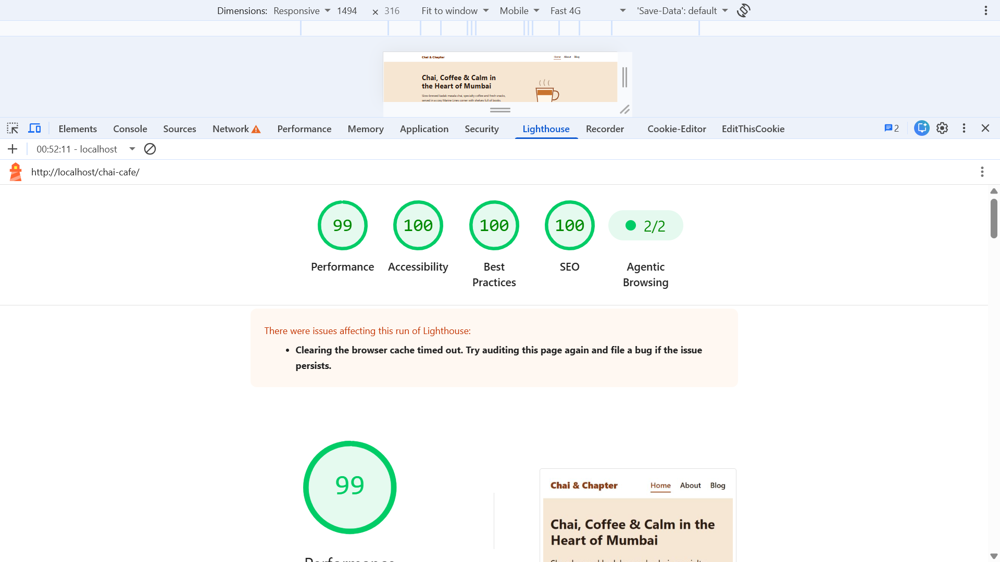

# ☕ Chai & Chapter Café

### Django + MySQL | SEO-Optimized Café Website

A modern, SEO-friendly website for a fictional Mumbai café, built using **Python, Django, and MySQL**.

The website includes three main pages — Home, About, and Blog — with dynamic blog posts and SEO metadata stored in the database. It follows SEO best practices, uses semantic HTML, and includes automated tests to verify important website features.

## ✨ Features

* **Home Page:** Introduces the café, its offerings, and its atmosphere.
* **About Page:** Shares information about the café and its story.
* **Blog System:** Displays blog posts with individual pages and clean URLs.
* **MySQL Database:** Stores blog posts, page information, and SEO metadata.
* **Dynamic SEO Metadata:** Generates unique page titles, meta descriptions, and canonical URLs from database content.
* **Open Graph Tags:** Helps pages display meaningful previews when shared on social media.
* **SEO-Friendly URLs:** Uses clean URLs for blog posts.
* **XML Sitemap:** Automatically generates a sitemap using Django's sitemap framework.
* **Robots.txt:** Provides crawler instructions and references the sitemap.
* **Structured Data:** Includes `CafeOrCoffeeShop` JSON-LD on the homepage.
* **Semantic HTML:** Uses proper page landmarks and a logical heading hierarchy.
* **Image Accessibility:** Includes alternative text and image dimensions.
* **Custom 404 Page:** Returns a proper 404 response for unknown blog posts and prevents search engines from indexing those error pages.
* **Django Admin:** Allows authorized administrators to manage blog posts.
* **Automated Tests:** Tests important SEO, accessibility, sitemap, robots.txt, and error-handling requirements.

## 🛠️ Tech Stack

| Technology               | Purpose                          |
| ------------------------ | -------------------------------- |
| Python                   | Core programming language        |
| Django                   | Backend web framework            |
| MySQL                    | Database                         |
| HTML5                    | Website structure                |
| CSS3                     | Styling and responsive layout    |
| Django Templates         | Dynamic page rendering           |
| Django Admin             | Content management               |
| Gunicorn                 | Production WSGI server           |
| WhiteNoise               | Static file serving              |
| Django Testing Framework | Automated testing                |

## 📁 Project Structure

```text
Chai-Cafe/
├── manage.py
├── requirements.txt
├── README.md
├── lighthouse-home.png
├── config/
│   ├── settings.py
│   ├── urls.py
│   └── wsgi.py
├── cafe/
│   ├── models.py
│   ├── views.py
│   ├── urls.py
│   ├── sitemaps.py
│   ├── admin.py
│   ├── tests.py
│   ├── migrations/
│   └── management/commands/seed_cafe.py
├── templates/
│   ├── base.html
│   ├── home.html
│   ├── about.html
│   ├── blog_list.html
│   ├── post_detail.html
│   └── 404.html
└── static/
    ├── css/
    └── img/
```

## 🚀 Getting Started

Follow these steps to run the project on your local computer.

### Prerequisites

* Python 3.12 or another version supported by your dependencies
* MySQL Server
* Git
* A code editor, such as Visual Studio Code

### Step 1: Clone the Repository

```bash
git clone https://github.com/ranjeetkanojya39/Chai-Cafe.git
cd Chai-Cafe
```

If the Django project is stored in a subfolder, navigate into that folder (the one containing `manage.py`) before running the commands below.

### Step 2: Create a Virtual Environment

**Windows — PowerShell:**

```powershell
python -m venv venv
.\venv\Scripts\Activate.ps1
```

If PowerShell blocks script execution, activate the environment using Command Prompt instead:

```bat
venv\Scripts\activate.bat
```

**macOS / Linux:**

```bash
python3 -m venv venv
source venv/bin/activate
```

### Step 3: Install Dependencies

```bash
python -m pip install --upgrade pip
pip install -r requirements.txt
```

### Step 4: Create the MySQL Database

Open your MySQL client and execute:

```sql
CREATE DATABASE chai_cafe_django
CHARACTER SET utf8mb4
COLLATE utf8mb4_unicode_ci;
```

Make sure MySQL Server is running before continuing.

### Step 5: Configure Environment Variables

The application needs database credentials.

**Windows PowerShell:**

```powershell
$env:DB_NAME = "chai_cafe_django"
$env:DB_USER = "root"
$env:DB_PASS = "your_mysql_password"
```

Replace `your_mysql_password` with your actual MySQL password. If your MySQL server is not on `127.0.0.1:3306`, also set `DB_HOST` and `DB_PORT`.

**Important:** These commands apply only to the current PowerShell session. Configure environment variables in your hosting provider when deploying.

Never commit database passwords, production secret keys, or other sensitive credentials to GitHub.

### Step 6: Run Database Migrations

```bash
python manage.py migrate
```

### Step 7: Load Sample Café Data

```bash
python manage.py seed_cafe
```

This loads the page metadata and sample blog posts. It is safe to run more than once.

### Step 8: Create an Admin Account (Optional)

```bash
python manage.py createsuperuser
```

Once the server is running, open `/admin/` to manage pages and blog posts.

### Step 9: Start the Development Server

```bash
python manage.py runserver
```

Open the website in your browser: `http://127.0.0.1:8000/`

## 🗺️ Website Routes

| Route          | Description                     |
| -------------- | ------------------------------- |
| `/`            | Café homepage                   |
| `/about`       | Information about the café      |
| `/blog`        | Blog listing page               |
| `/blog/<slug>` | Individual blog post            |
| `/sitemap.xml` | XML sitemap for search engines  |
| `/robots.txt`  | Search crawler instructions     |
| `/admin/`      | Django administration interface |

The blog routes use clean URLs, such as `/blog/best-chai-in-mumbai`.

## 🔍 SEO Implementation

### 1. Dynamic Meta Titles and Descriptions

Page titles and meta descriptions are stored in MySQL and rendered dynamically, so every page has its own unique title and description.

### 2. Canonical URLs

Canonical tags identify the preferred URL for each page.

### 3. Open Graph Metadata

Open Graph tags provide title, description, and type information for social media previews.

### 4. Semantic HTML and Heading Hierarchy

Each page has exactly one `<h1>` followed by a logical `h2` → `h3` order, with semantic landmarks (`header`, `nav`, `main`, `article`, `footer`).

### 5. XML Sitemap

The sitemap is generated from database content using Django's sitemap framework, and blog posts include their last-modified dates.

### 6. Robots.txt

The robots.txt endpoint provides crawler instructions and links to the XML sitemap.

### 7. Structured Data

The homepage includes `CafeOrCoffeeShop` (a LocalBusiness type) JSON-LD with address, geo coordinates, and opening hours.

### 8. Accessible Images

Every image has alternative text and explicit width and height attributes to help reduce layout shifts.

### 9. Proper 404 Handling

Unknown URLs and blog slugs return a real HTTP 404 response with a `noindex` directive.

## 🧪 Running Tests

```bash
python manage.py test
```

The test suite checks:

* One `<h1>` per page and correct heading order
* Unique page titles and meta descriptions
* Alternative text on every image
* `CafeOrCoffeeShop` JSON-LD on the homepage
* XML sitemap and robots.txt
* Correct 404 responses with `noindex`

## 🚀 Deployment Guide — Render

### Build Command

```bash
pip install -r requirements.txt
python manage.py collectstatic --noinput
python manage.py migrate
python manage.py seed_cafe
```

The seed command updates existing sample records by slug, so run it only when you want to reset that content.

### Start Command

```bash
gunicorn config.wsgi
```

### Environment Variables

| Variable               | Purpose                                      |
| ---------------------- | -------------------------------------------- |
| `DEBUG`                | Set to `0` in production                     |
| `SECRET_KEY`           | A secure, private Django secret key          |
| `ALLOWED_HOSTS`        | Your deployed hostname                       |
| `CSRF_TRUSTED_ORIGINS` | Trusted HTTPS origin, e.g. `https://app.onrender.com` |
| `DB_NAME`              | Hosted database name                         |
| `DB_USER`              | Database username                            |
| `DB_PASS`              | Database password                            |
| `DB_HOST`              | Database server hostname                     |
| `DB_PORT`              | Database server port, if required            |

**Before deploying:** make sure the hosted MySQL database is reachable from the application.

## 📊 Lighthouse Performance Testing

Use Google Chrome Lighthouse to review the website's performance, accessibility, SEO, and best practices.

### How to Run Lighthouse

1. Start the website locally or open its deployed URL.
2. Open the page in Google Chrome (Incognito mode gives cleaner results).
3. Open Developer Tools using `F12`.
4. Select the **Lighthouse** tab.
5. Choose **Mobile** as the device.
6. Select the relevant audit categories.
7. Click **Analyze page load**.
8. Save a screenshot of the scores as `lighthouse-home.png` in the project root folder.

### Lighthouse Result (Home Page)



## 🔐 Security Notes

* Never upload production secrets or database passwords to GitHub.
* Keep `DEBUG` disabled in production.
* Configure `ALLOWED_HOSTS` for your deployed domain.
* Use HTTPS in production.
* Restrict administrative access to authorized users.
* Ensure the database user has only the permissions the application needs.
* Use environment variables or a secure secrets manager for sensitive settings.

## 🎯 Project Goals

This project demonstrates practical skills in:

* Python and Django web development
* MySQL database integration
* Dynamic content management
* SEO-friendly website architecture
* Django templates and semantic HTML
* XML sitemaps and structured data
* Automated testing
* Production deployment configuration

## 👨‍💻 Author

**Ranjeet Kanojiya**

Python Full Stack Developer

GitHub: [ranjeetkanojya39](https://github.com/ranjeetkanojya39)

---

*Chai & Chapter Café is a fictional café created as a web development project for learning and demonstration purposes.*
